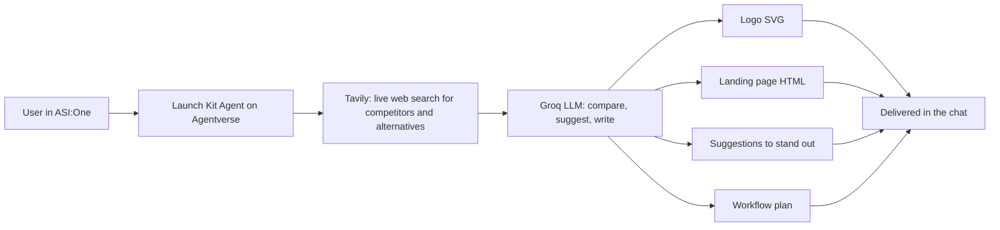

<p align="center">
  
  
</p>

# Launch Kit Agent

An AI agent on Agentverse, used through ASI:One, that turns a product idea into the assets you need to launch it: a logo, a landing page, a live market comparison with suggestions on how to stand out, and a workflow plan for what to do next. Everything happens inside the chat, with no custom frontend.

**Built for:** Fetch-A-Thon 3.0, ASI:One Agent Challenge: From Intent to Action.

## Demo links

| What | Link |
|---|---|
| ASI:One shared chat (full workflow) | `<add shared chat URL>` |
| Agentverse agent profile | `<add agent profile URL>` |
| Demo video | `<add video URL>` |

## The problem

Launching a product means doing market homework, creating a brand, building a page and deciding what to do next. Founders, students and small teams rarely have a designer, a marketer and a strategist on hand, and generic AI chat gives advice without producing anything usable or checking the real market.

## Target users

Solo founders, indie makers, students and small teams who need a credible launch starting point quickly.

## The outcome

From a short description of a product, the agent produces in the same conversation:

1. **Market comparison:** live web research on competitors and alternatives, with a comparison of your product against them
2. **Suggestions to stand out:** concrete ideas for positioning and differentiation based on that research
3. **A logo** as an SVG you can save and use
4. **A landing page** as a single HTML file you can open in a browser
5. **A workflow plan:** recommended next steps and how the product can continue to grow

## How it works



- **Tavily** provides real-time web search, so the competitor analysis uses current information instead of model memory.
- **Groq** runs the language model that compares your product to the market and writes the suggestions, logo, page and plan.
- The agent is a uAgent that implements the **Agent Chat Protocol**, is hosted on **Agentverse**, and is discoverable and usable through **ASI:One**.

## Try it

Send a message like these in ASI:One:

| Prompt | What to expect |
|---|---|
| `I'm building a plant care app for beginners` | The agent researches the market and compares your idea to competitors |
| `Make me a logo and landing page for my plant care app called Leafy` | A logo SVG and a landing page |
| `How can my app stand out from the competition?` | Suggestions based on the live comparison |
| `What should I do next to grow it?` | A workflow plan with next steps |

## Challenge requirements and evidence

| Requirement | Status | Evidence |
|---|---|---|
| Register at least one agent on Agentverse | Done | Agent profile link above |
| Implement the Agent Chat Protocol | Done | Chat protocol handlers in the agent code |
| Discoverable and usable through ASI:One | Done | Agent profile README (see `AGENTVERSE_README.md`) and the shared chat link above |
| Meaningful tool execution | Done | Live Tavily search plus Groq-powered analysis and generation of a logo, landing page, suggestions and workflow plan |
| Multi-step planning and orchestration | Done | Research, then comparison, then asset generation, then planning |
| Complete primary workflow inside ASI:One | Done | The shared chat link above; no custom frontend |
| Public GitHub repo with run and test instructions | Done | This README |
| Bonus: real-time data and external services | Done | Tavily web search and the Groq API |

## Run it

### Hosted on Agentverse (what the demo uses)

1. In Agentverse, create a new hosted agent (**Agents**, then **+ Launch an Agent**, then **Blank Agent**).
2. Open the **Build** tab. Put the entry code in `agent.py`. If the project has more than one file, create the others with **+ New File**; imports between files work in the hosted editor.
3. Add your keys under **Secrets** (see below), then click **Start** and check the logs for the agent's address.
4. Paste `AGENTVERSE_README.md` into the agent's README on its profile so ASI:One can discover it.
5. Open the agent from its profile (**Chat with Agent**) or find it in ASI:One and start chatting.

### Configuration

Set these as secrets in Agentverse (or as environment variables if you run locally).

| Variable | Purpose |
|---|---|
| `TAVILY_API_KEY` | Live web search. Tavily's free plan includes 1,000 credits per month with no card; a basic search costs 1 credit. |
| `GROQ_API_KEY` | Access to the Groq-hosted language model. |

> Make sure these names match the ones your code reads. If your code uses different names, update this table.

### Run locally (optional)

```bash
git clone <this repo> && cd <this repo>
uv init            # or: python -m venv .venv && source .venv/bin/activate
uv add uagents requests
export TAVILY_API_KEY="..."
export GROQ_API_KEY="..."
export AGENT_SEED="<a long secret phrase>"
uv run python agent.py
```

For a local agent, create it with a mailbox (for example `Agent(name="launch_kit_agent", seed=..., port=8001, mailbox=True)`), open the inspector link printed in the logs and connect the **Mailbox** so ASI:One can reach it.

## Testing

1. Start the agent and confirm its address appears in the logs with no errors.
2. Open **Chat with Agent** and send `hi`. You should get a normal reply.
3. Send a product idea and confirm you get the market comparison and suggestions.
4. Ask for a logo and a landing page. Save the logo as `logo.svg` and the page as `index.html`, then open both in a browser.
5. Ask for next steps and confirm a workflow plan comes back.
6. Remove one API key and confirm the agent responds with a clear message instead of crashing.

## Limitations

- Market analysis quality depends on what Tavily finds for your product category. Very niche products may return fewer competitors.
- Tavily's free tier is limited to 1,000 credits per month and Groq has its own rate limits, so heavy use can hit quotas.
- The landing page is static HTML with no signup backend, and the logo is a vector concept to refine, not a finished brand identity.
- Generated suggestions are starting points. Verify competitor details before publishing them.

## Roadmap

- ASI Interactive Cards for guided intake and review
- Multiple specialist agents (research, design, strategy) collaborating
- More data sources and one-click hosting of the landing pagealist agents for research, writing and design, with an independent auditor
- More data sources and one-click hosting of the landing page
