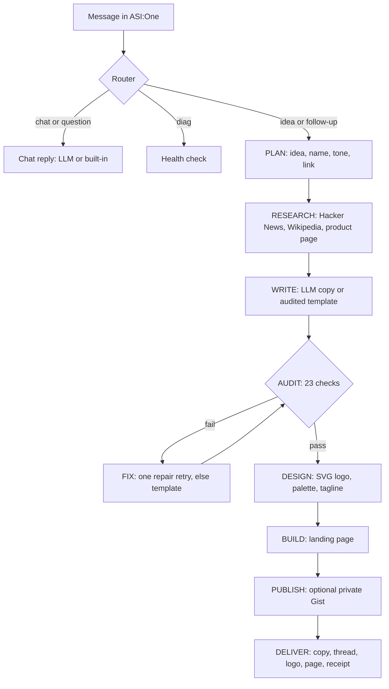

# Launch Kit Agent

A friendly AI agent on Agentverse that you can chat with, and that turns a one-line product idea into a finished, audited launch kit entirely inside an ASI:One conversation: live market research, landing page copy, a 6-tweet launch thread, an SVG logo with palette and tagline, and a polished, ready-to-open landing page. It checks its own work before delivering and repairs or replaces anything that fails.

**Built for:** Fetch-A-Thon 3.0, ASI:One Agent Challenge: From Intent to Action.

## Demo links

| What | Link |
|---|---|
| ASI:One shared chat (full workflow) | https://asi1.ai/ai/agent1qvc7sunrshhkkgg2lps6fyrpwkfy8rj45eqmexd242flwdmsz2tvux4ms6c |
| Agentverse agent profile | (https://agentverse.ai/agents/details/agent1qvc7sunrshhkkgg2lps6fyrpwkfy8rj45eqmexd242flwdmsz2tvux4ms6c/profile) |

## The problem

Launching a product means producing a pile of assets (copy, social posts, a logo, a page) and doing market homework first. Most AI tools return one unchecked blob of text, and the person still has to verify it, fix it and assemble it.

## Target users

Solo founders, indie makers, students and small teams who need a credible launch kit fast and have no designer, copywriter or time.

## The outcome

From a message like *"Launch my travel planning app called Wanderly. Tone: playful."* the agent delivers, in the same chat:

1. **Live research** with source links (Hacker News, Wikipedia, and your product page if you give a URL)
2. **Landing page copy:** headline, subhead, 3 benefits, call to action, a 3-step "how it works" and a 3-question FAQ
3. **A 6-tweet launch thread**, every tweet at or under 280 characters
4. **An SVG logo,** a 4-colour palette and a 6-word tagline (three logo styles across six palettes)
5. **A polished single-file landing page** (details below) that opens in any browser
6. **An audit report** (23 automated checks) and a receipt showing what ran live and what fell back
7. Optionally, a **private GitHub Gist** containing the page, logo and thread

### The landing page

The generated page is one self-contained HTML file with no scripts and no external requests:

- Sticky navigation with the logo, section links and a call-to-action button
- Gradient hero with logo, tagline pill, headline, subhead and two buttons
- Feature cards with icons, a numbered "how it works" section, and live source cards ("what people are talking about") when research succeeded
- The launch thread rendered as tweet-style cards, and an FAQ accordion that works without JavaScript
- A closing call-to-action band and footer
- Responsive from phone to desktop, automatic dark mode, smooth scrolling and entrance animations that switch off for people who prefer reduced motion
- Accessible markup: semantic landmarks, labelled logo, visible keyboard focus, and text/background contrast checked across all six colour palettes
- Add a URL or an email (`email: you@example.com`) to your message and the buttons link there; otherwise they scroll to the launch thread

## It also just chats

You do not have to start with a command. The agent holds a normal conversation and gently steers toward building when you mention an idea:

- Greetings, small talk, thanks and "what can you do" get natural replies.
- Say *"I have an idea"* and it asks what you are building, then builds it.
- Say *"I'm building a notes app for students"* and it offers to build the kit; reply `yes` to start.
- With an `ASI_API_KEY`, open-ended chat is answered by the LLM and remembers the last few turns. Without it, built-in replies are used, so chat always works.

## How it works



Every step is narrated in the chat with a label (PLAN, RESEARCH, WRITE, FIX, DESIGN, AUDIT, PUBLISH, RECEIPT), so the work is easy to follow and verify.

**Reliability built in**

- Each web call has a short timeout; slow optional steps are skipped and reported, with a 45-second job limit.
- If live research fails, it falls back to cached sources and says so.
- If the LLM is missing, errors or returns copy that fails the audit, it retries once with the audit feedback, then falls back to an audited template. The reason is shown in the chat.
- Unexpected errors are reported with the error name instead of failing silently.
- A `diag` command checks the Python and `uagents` versions, storage, network access, the LLM key and model, and the GitHub token.

## Try it

Send any of these in ASI:One (or the agent's chat in Agentverse):

| Prompt | What to expect |
|---|---|
| `hi` / `how are you?` / `what can you do` | A friendly reply, no build |
| `I have an idea` | It asks what you are building, then builds it |
| `I'm building a notes app for students` | It offers a launch kit; reply `yes` |
| `Launch my travel planning app called Wanderly. Tone: playful.` | The full run, ending in an audit PASS and a receipt |
| `Launch my todo app called Taskly. Tone: bold` | Same flow; "todo" is handled correctly by the audit |
| `I want to promote a vegan bakery in Dehradun. Tone: professional` | Works without a brand name; one is derived |
| `Launch my fitness tracker called PulseFit https://example.com email: hi@example.com` | Reads your product page; buttons link to your URL |
| `make it bold` / `rename it to Zoomly` | Reruns your last idea with the change |
| `diag` | Health check of the agent and its integrations |

## Challenge requirements and evidence

| Requirement | Status | Evidence |
|---|---|---|
| Register at least one agent on Agentverse | Done | Agent profile link above |
| Implement the Agent Chat Protocol | Done | `chat_proto` in `launch_agent.py`: acknowledges every message, handles session start, publishes the manifest |
| Discoverable and usable through ASI:One | Done | Agent profile README (see `AGENTVERSE_README.md`) and the shared chat link above |
| Meaningful tool execution | Done | Live Hacker News and Wikipedia APIs, product page fetch, optional GitHub Gist API, 23 automated audit checks, SVG and HTML validation |
| Multi-step planning and orchestration | Done | The pipeline above, with an audit and repair loop and a conversation router |
| Complete primary workflow inside ASI:One | Done | The shared chat link above; no custom frontend |
| Public GitHub repo with run and test instructions | Done | This README |
| Bonus: error handling and recovery | Done | Time limit, fallbacks, repair retry, visible errors, `diag` |
| Bonus: real-time data and external services | Done | Hacker News, Wikipedia, product URL, GitHub Gist |
| Bonus: ASI Interactive Cards | Not implemented | See the roadmap below |
| Bonus: multi-agent collaboration | Not in the submitted agent | An earlier multi-agent prototype is described below |

## Run it

### Option A: hosted on Agentverse (what the demo uses)

1. In Agentverse, go to **Agents** and launch a new **Blank** hosted agent named `Launch Kit Agent`.
2. Replace the contents of `agent.py` with `launch_agent.py` and click **Start**.
3. Wait for `Launch Kit Agent v3 online. Address: agent1q...` in the logs.
4. Paste `AGENTVERSE_README.md` into the agent's README tab so ASI:One can discover it.
5. Optionally add the secrets below, then chat with it.

### Option B: run locally with a mailbox

```bash
git clone <this repo> && cd <this repo>
uv init            # or: python -m venv .venv && source .venv/bin/activate
uv add uagents requests
```

In `launch_agent.py`, change the agent line to:

```python
agent = Agent(name="launch_kit_agent", seed=os.environ["AGENT_SEED"], port=8001, mailbox=True)
```

Then:

```bash
export AGENT_SEED="<a long secret phrase>"
uv run python launch_agent.py
```

Open the Agent inspector link printed in the logs and connect the **Mailbox**.

### Configuration (all optional)

Set these in Agentverse under the agent's **Secrets**, or as environment variables locally.

| Variable | Purpose |
|---|---|
| `ASI_API_KEY` | Enables LLM chat and LLM-written copy. Without it, built-in chat replies and the audited template are used. |
| `ASI_MODEL` | Model name, default `asi1`. Send `diag` to confirm it works. |
| `GITHUB_TOKEN` | A token with the `gist` scope. Enables the private Gist publish step. |

## Testing

1. Send `diag`. Every line should read OK for the integrations you configured.
2. Chat for a few turns (`hi`, `how are you?`, `what can you do`) and confirm it replies without building anything.
3. Run the idea prompts in the table above and check that the audit line reads `AUDIT: PASS`.
4. Save the landing page output as `index.html` and open it in a browser. Resize the window, toggle dark mode, and open the FAQ items.
5. Save the logo output as `logo.svg` and open it.
6. To see the recovery path, set an invalid `ASI_MODEL`. The chat shows the LLM error and the agent still replies and delivers using built-in replies and the audited template.

## Repository layout

| Path | Purpose |
|---|---|
| `launch_agent.py` | The submitted agent (single file, hosted-agent compatible) |
| `AGENTVERSE_README.md` | Text for the Agentverse profile README |
| Other `*.py` agent files, if present | An earlier multi-agent prototype, kept for reference. Not part of the submitted flow. |

## Limitations

- Without an LLM key, copy comes from a template, so it is clean and audited but generic, and open-ended chat uses built-in replies.
- Research depends on the public Hacker News and Wikipedia APIs. Niche topics can return few results.
- The landing page is static HTML with no signup backend. Buttons link to your URL or email when you provide one.
- The page and logo are delivered as text in the chat; save them to files to open them.

## Roadmap

- ASI Interactive Cards: an intake form for tone and brand, a review screen, and approve or revise buttons
- Re-introduce multi-agent collaboration: specialist agents for research, writing and design, with an independent auditor
- More data sources and one-click hosting of the landing page
